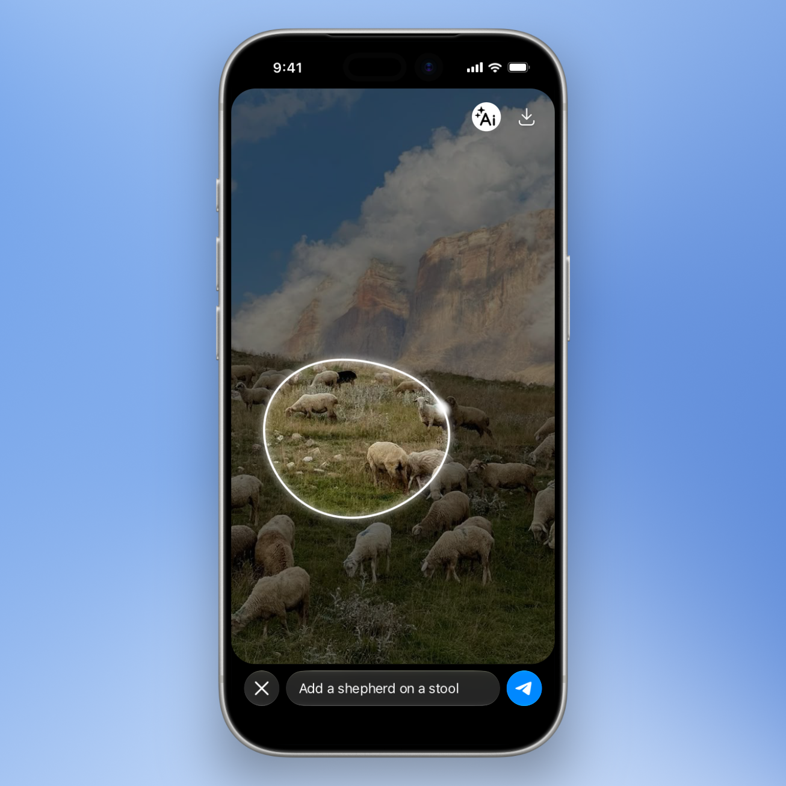

# AI Edits in Stories for Telegram iOS

Change one part of a story photo by circling it and telling the Agent what to put there. Tap the AI button in the story editor, circle the place with your finger, type what you want and send: only the circled part changes, the rest of the photo stays exactly as it was.

[](Media/demo.mp4)

▶︎ [Media/demo.mp4](Media/demo.mp4) — the concept, animated (14 s).

## Why

Editing a photo before posting a story means leaving Telegram for another app. The story editor already has one AI entry point: the sticker panel's Image button opens Apple's Image Playground and adds the picture on top of the photo as a sticker. It can add things over a photo, but it cannot change the photo itself.

This adds a way to change the photo: circle where, say what. The finger tells the Agent exactly which part to work on, so the request can stay short ("Add a shepherd on a stool") and nothing outside the circle is touched.

## What it does

- **An AI button in the story editor.** For a photo, a button with the app's own AI icon sits in the top row, 50 pt left of Save, where the editor puts its mute and play buttons for a video.
- **Circle what to change.** The editor's controls step aside and the bottom row says "Circle what to change". The finger draws a glowing line; when it lets go, the loop closes, the rest of the photo dims and a light runs round the selection. Drawing again replaces it.
- **Tell the Agent.** The hint stretches into a text field with the Agent's own placeholder, "Ask Agent anything", and a blue send button appears once there is text.
- **While it works.** The selection goes soft and a little lighter, a shimmer crosses it, star sparkles twinkle and the light runs round three times as fast.
- **Only the selection changes.** The result is pasted into the original through the selection with a soft edge and becomes the editor's photo. Crop, tools and stickers stay as they were, and the story is posted with the edit.

## How it works

| Piece | Where |
| --- | --- |
| The overlay: lasso, dim, light, the bar, the working state, the reveal | `MediaEditorAIEdit.swift` (new) |
| The edit service, its stub, the mask and the compositing | `MediaEditorAIEditService.swift` (new) |
| Swapping the photo the editor draws | `MediaEditor.swift` |
| The button and the hooks | `MediaEditorScreen.swift` |

- **The button.** A `CameraButton` with `Media Editor/AI` (the icon of the sticker panel's Image button), the editor's button shadow, shown only for photos in the story editor. It appears and goes with the other top buttons.
- **The selection.** Drawn on the preview and mapped into the photo's pixels through the editor's own media entity, so the photo's crop, scale and rotation are respected. The loop closes at the point of the stroke's second half nearest its start; the part drawn past the start fades. The light runs round it at the pace of the editor's cut-out outline (one lap takes length / 135 s, kept between 3 and 8 s).
- **The bar.** Built from the same glass pieces and geometry as the editor's bottom row, so the close button, the field and the send button sit where the row's back button, tools and Next are. The photo moves up with the keyboard, as it does for a tool.
- **The edit.** `MediaEditorAIEditService` takes the photo, a mask and the request and returns a picture. Telegram's Agent keeps provider keys on the server and its API is not available in this build (`TelegramEngineAgent.swift`, `agentApiIsAvailable`); a production version would send the photo, the mask and the request through it. This concept ships a stub instead (see Limitations).
- **Applying.** The service's picture is blended into the original through the mask (3 pt soft edge), and `MediaEditor.replaceMainImage(_:)` swaps the photo the renderer draws, the way the night-theme switch swaps its image. The edited photo also becomes the screen's subject, so drafts, Save to Gallery and stories exported as video carry the edit.

## Repository

| Path | What |
| --- | --- |
| `changes.patch` | The whole feature as one patch for Telegram-iOS: 5 files, +1228 −3 |
| `Sources/` | The new files from the patch, for reading |
| `Media/demo.mp4` | The concept, animated |

## Changes

| File | Change |
| --- | --- |
| `submodules/TelegramUI/Components/MediaEditorScreen/Sources/MediaEditorAIEdit.swift` | New: the AI edit overlay |
| `submodules/TelegramUI/Components/MediaEditorScreen/Sources/MediaEditorAIEditService.swift` | New: the service protocol, the stub, the mask and the compositing |
| `submodules/TelegramUI/Components/MediaEditorScreen/Sources/MediaEditorScreen.swift` | The AI button, the overlay's hooks, applying the result |
| `submodules/TelegramUI/Components/MediaEditor/Sources/MediaEditor.swift` | `replaceMainImage(_:)` |
| `Telegram/Telegram-iOS/en.lproj/Localizable.strings` | Two strings: "Edit with Agent", "Circle what to change" |

## Trying it

This is a change to the Telegram-iOS source tree, not a standalone app. Apply the patch to a checkout of [TelegramMessenger/Telegram-iOS](https://github.com/TelegramMessenger/Telegram-iOS) (made against `master` at `24638bc69b`, 3 Nov 2026) and build the app as usual:

```sh
git apply changes.patch
```

Start a story, take or pick a photo, tap the AI button next to Save, circle a part of the photo, type a request and send.

## Limitations

- **The edit is a stub.** No image model is called: after 2 s the circled part comes back brighter and more saturated, so the whole flow can be tried without a server. The demo video shows the kind of result a real model would return.
- **No undo** for an edit. After an edit of a gallery photo, swipe-down to close stops working for that session (Back still works), and a draft saved after it loses the photo's location.
- **New strings are not localized** (English only).
- **Verified:** the app builds for the simulator. **Not verified:** the feature in a running app with an account: the glass look, the bar's place above the keyboard on every device, the blur of the working state.

## Media credits

The video is a concept render, not a screen recording. The meadow photo is used for illustration; the shepherd in the result was added to it for the demo.

## License

Telegram-iOS is distributed under the GNU General Public License v2.0, and so is this patch. See [LICENSE](LICENSE).
